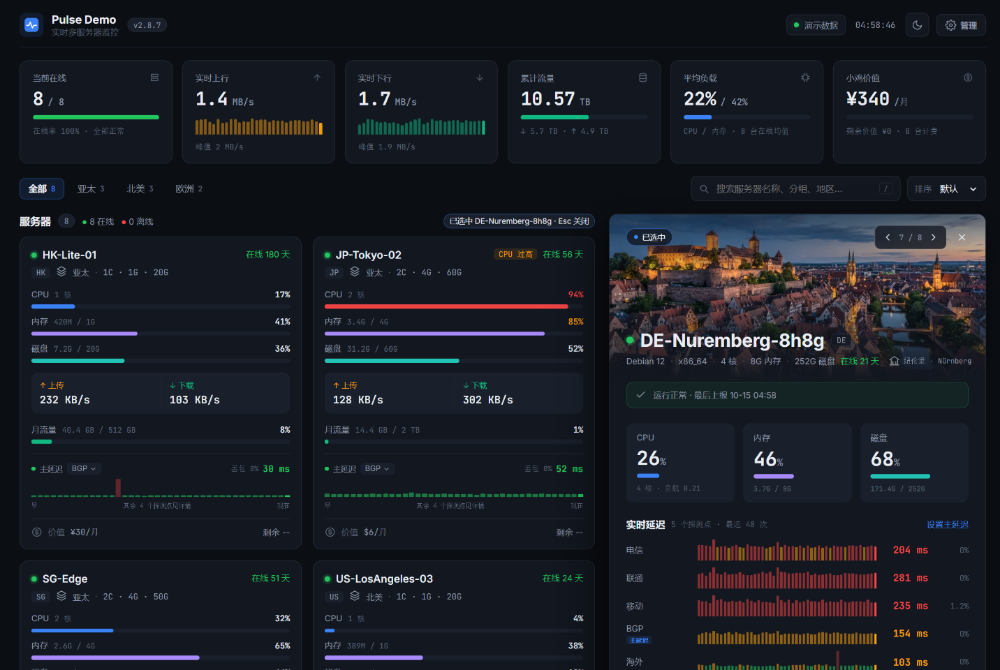

# Pulse · CF-Server-Monitor Theme

[](https://github.com/huilang-me/CF-Server-Monitor)
[](LICENSE)

为 [CF-Server-Monitor](https://github.com/huilang-me/CF-Server-Monitor) 设计的深色 / 浅色双模式仪表盘主题。原生 ES Module + CSS 实现，无构建步骤、无第三方依赖。



## 特性

- **主延迟实时图**：每张服务器卡片只展示 1 个「主延迟」探测点的实时柱状图（按延迟分级着色、丢包高亮），其余探测点在详情侧栏里完整展示。
- **可设置主延迟**：点击卡片上的探测点标签即可切换。可只改当前服务器，也可一键应用到全部服务器；登录后台后还能同步保存到站点 `theme_options`，所有访客生效。
- **响应式详情侧栏**：点击卡片后，卡片网格自动重排（例如 3 列 → 2 列），右侧滑出大卡片。窄屏下变为抽屉浮层，手机端变为底部弹出面板。
- **地标插图（区分深浅色）**：侧栏顶部按服务器所在地区显示地标照片。深色模式用黄昏 / 夜景，浅色模式用晴朗白天，切换外观时自动更换。
  - 覆盖地区：洛杉矶、纽约、华盛顿、盐湖城、旧金山、纽伦堡、巴黎、伦敦、阿姆斯特丹、东京、香港、新加坡、首尔、台北、上海，外加通用数据中心图，共 16 组 × 2 张。
  - 图片由 AI 生成并随主题打包；其他地区显示数据中心图，也可通过 `theme_options.pulse.landmarks` 指定。
- **详情侧栏内容**：CPU / 内存 / 磁盘，全部探测点实时延迟，24 小时 CPU / 内存 / 网络趋势，以及负载、进程、连接数、磁盘 IO、流量、价格、到期等系统详情。
- **总览**：在线数、实时上行 / 下行（带走势）、累计流量、平均负载、小鸡价值（实时汇率折算人民币，含剩余价值）。
- **实时与额度友好**：
  - 使用 `/api/ws` 订阅并携带 `ids` 过滤；页面隐藏时断开，可见时先补 REST 再重连。
  - 遵守 `frontend_ws_timeout_minutes`，到时暂停并询问是否继续。
  - WebSocket 不可用时自动降级为 REST 轮询。
- **其他**：支持 Turnstile 验证、非公开站点 JWT、跨域 `apiBase` 静态部署；分组标签、搜索（`/` 快捷键）、按 CPU / 内存 / 主延迟 / 月流量排序。

## 安装

### 方式一：主题商店 / 后台安装

在后台「主题商店」的自定义主题地址中填写，地址必须是 `https://github.com/<用户>/<仓库>/tree/<分支或提交>` 格式。直接填仓库首页地址（不带 `/tree/...`）会提示「主题 URL 格式无效」。

```text
# 跟随 main 分支更新（Worker 会缓存一段时间）
https://github.com/brianky197/Pulse-CF-Server-Monitor/tree/main

# 固定到某个提交（永久缓存，加载最快，升级时换成新的提交号）
https://github.com/brianky197/Pulse-CF-Server-Monitor/tree/<commit-sha>
```

也可以提交到 [CFSM-Theme-Store](https://github.com/huilang-me/CFSM-Theme-Store)。主题产物只包含 `index.html` 与 `assets/`，符合官方主题目录约定。

### 方式二：静态部署（GitHub Pages / Cloudflare Pages）

1. Fork 本仓库并开启 Pages。
2. 在 `index.html` 中取消注释并填写 Worker 地址：
   ```html
   <meta name="apiBase" content="https://your-cf-server-monitor.workers.dev">
   ```
3. 在 Worker 环境变量 `CORS_ALLOWED_ORIGINS` 中加入你的 Pages 域名（只填 origin，例如 `https://username.github.io`）。

### 本地预览

```bash
python -m http.server 5178
# 打开 http://127.0.0.1:5178/?demo=1 查看演示数据
```

## 主题配置（theme_options）

`theme_options` 由所有主题共享，Pulse 只读写其中的 `pulse` 命名空间，不会覆盖其他主题的配置。所有字段均可选：

```json
{
  "pulse": {
    "primary_probe": "ct",
    "primary_overrides": { "<serverId>": "bd" },
    "latency_thresholds": [100, 200],
    "landmarks": {
      "de": {
        "dark": "https://raw.githubusercontent.com/you/assets/main/nuremberg-night.jpg",
        "light": "https://raw.githubusercontent.com/you/assets/main/nuremberg-day.jpg"
      },
      "<serverId>": "/assets/landmarks/jp.jpg"
    }
  }
}
```

| 字段 | 说明 |
| --- | --- |
| `pulse.primary_probe` | 全站默认主延迟：`ct` / `cu` / `cm` / `bd` / `node_1` … `node_4` |
| `pulse.primary_overrides` | 按服务器 ID 覆盖主延迟 |
| `pulse.latency_thresholds` | 延迟分级阈值（毫秒），默认 `<100` 绿、`<200` 黄、其余红 |
| `pulse.landmarks` | 地标图覆盖，键可以是地区（如 `de`、`us-la`）或服务器 ID；值为图片 URL，或 `{ "dark": "...", "light": "..." }` 分别指定深色 / 浅色模式的图 |

访客在卡片上切换的主延迟只保存在本机浏览器，优先级高于站点配置。

## 说明

- 管理后台由 CF-Server-Monitor 内置默认主题接管，本主题的「管理」按钮跳转到 `/admin#/admin`。
- 旗帜图标使用后端自带的 `/flags/<code>.svg`。
- 地标图片受 CSP 限制，只能来自同源、`raw.githubusercontent.com` 或后台 `csp_static` 白名单域名。

## 致谢

- [CF-Server-Monitor](https://github.com/huilang-me/CF-Server-Monitor)：探针与 API。
- [Horizon](https://github.com/akasls/Horizon-CF-Server-Monitor)：主题结构参考，API Client / Turnstile / WebSocket 部分改编自该项目（MIT）。

## License

[MIT](LICENSE)
